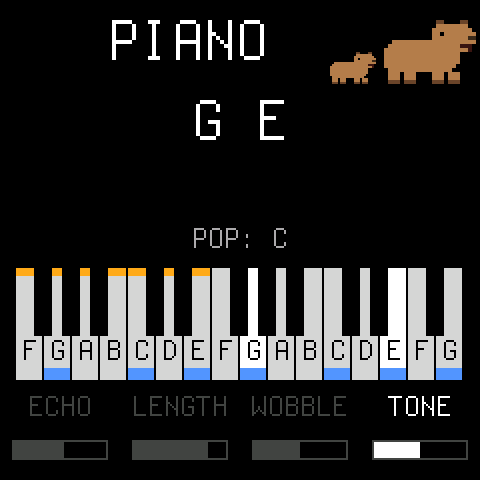
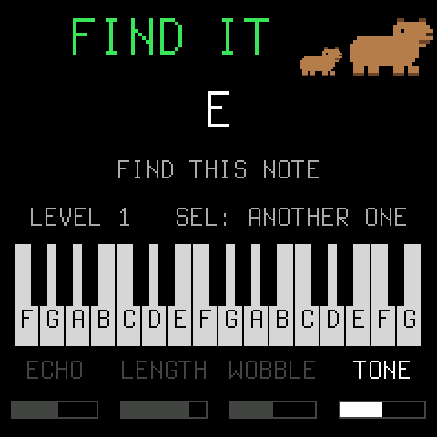
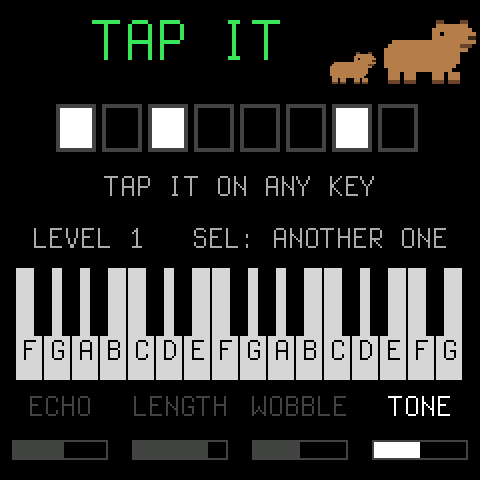

# Capy

**A first real instrument for a child of five to seven, on the M-VAVE FM-1.**

Capy replaces the FM-1's firmware with a small keyboard instrument. What it holds to:

1. **She is the musician.** Nothing plays unless she plays it or switched it on: her own recording, and a band she
   starts and plays over. No demo songs.
2. **Real instruments and real names.** Piano, organ, bells, guitar, bass, strings, brass, flute; notes by their
   letters, chords by their names. What she learns here is true at any piano.
3. **Every button does what is printed on it.** There are two places, playing and the games, and HOME always goes
   back.
4. **The games don't run out.** They make their questions up, get a little harder after five right answers and
   remember their level. A wrong answer takes nothing away.

A capybara and her baby sit beside the instrument's name. She sings when notes sound, nods to the band, blinks,
and gets a yuzu on her head for a chord or a right answer (a right answer also makes every key's light breathe once, without
a sound over hers). HOME (and switching on) shows their pond, which stays until she plays or picks something. Little scenes play
there one after the other (a baby jumps into the water, rides on her mother's back, a wren lands and sings, the
mother dozes off, yuzus drop in for a bath), and OCT- and OCT+ step through them. In the pond: every three
levels gained in the games, another baby moves in, up to five.

<p>









</p>

> **Status: runs on an FM-1.** Each change is checked in the host simulator (`tests/run_host.sh`), which runs the
> same code and writes the screen and the sound to files, and then tried on one FM-1. The device package is built
> by GitHub Actions, where the build's own safety checks pass. Install it with a computer nearby and read
> [If it goes wrong](docs/MANUAL.md#if-it-goes-wrong) first. Installing firmware is at your own risk. (Capy was
> first called Wren; a wren still visits the pond.)

## Playing

| Control | What it does |
| --- | --- |
| Keys | Play. Twelve notes at once. The screen names what she holds: one note's letter, several notes' letters, or the chord ("C MAJOR", "A MINOR", "G7"). |
| **PRESETS** | The instrument: PIANO, ORGAN, BELLS, GUITAR, BASS, STRINGS, BRASS, FLUTE, and DRUMS: a drum kit on the keys (C kick, D snare, E clap, F and G toms, A hat, B cymbal, the black keys sticks), each named on the screen as she hits it. |
| **OCT-**, **OCT+** | Lower, higher. |
| **KNOB 1**, **FX** | ECHO. The knob sets how much, FX switches it on and off. |
| **KNOB 2**, **ENV** | LENGTH: how long notes ring. The knob sets how much, ENV switches it on and off. |
| **KNOB 3**, **LFO** | WOBBLE: vibrato. The knob sets how much, LFO switches it on and off. |
| **KNOB 4** | TONE: dark to bright. |
| **GLO** | The note letters (on the screen's keys, and what she holds), or the sound's wave instead. |
| **ARP** | Held keys play one after the other. |
| **SEQ** | Each press the next one: CLICK (a metronome, four in a bar), then the bands POP, BLUES, WALTZ, LULLABY, then off. A band plays first only its drums. A low key (F to E, marked orange on the screen) leads it: the bass and the chords play that key's chord until she picks another. The screen says the chord; the keys that fit glow, the others still play. |
| **ALGORITHM** | SPEED of the band, the arp and the recording (60 to 180). |
| **SELECT** | Which of her four songs: SONG 1 to SONG 4. REC, PLAY, SAVE and EDIT mean the one that shows; the song she turns away from is kept. |
| **REC** | Record what you play. REC again and it goes round. REC while it plays adds a layer, with any instrument. |
| **PLAY** | The recording on and off. |
| **EDIT** | Tap: take the last layer away. Hold a second: erase the recording. |
| **SAVE** | Keep the song that shows for next time. |
| **SEL** | The games. |
| **HOME** | Back to the start: piano, everything off, and the pond, where OCT- and OCT+ step through its scenes. The recording is kept. |
| **MASTER** | Volume. |
| **HOME held 3 s** | For grown-ups: QUIET, half the loudness, kept over power-off. |

## The games

**SEL** goes in, **SELECT** picks the game, **SEL** again asks for another question, **SEQ** switches the click (a
metronome) on and off, **HOME** leaves. The
instrument, the knobs and the keys work as always.

| Game | What she does | How it grows |
| --- | --- | --- |
| **TUNES** | The next key of a tune is green and waits for her; the screen says its letter. She plays every note, and a band plays with her, at her pace: a bass and a chord where the tune's chord comes, a tick of the hat in between. | Nine traditional tunes, one after the other. |
| **FIND IT** | The screen shows a letter: find that key. A wrong key is named ("THAT WAS C"); after two, the right keys light. | C D E, then up to G, all white keys, the black keys. |
| **COPY ME** | It plays a few notes, she plays them back. Each time right, one note more. | From 2 notes up to 12, on more keys. |
| **HIGH LOW** | Two notes: was the second higher or lower? OCT+ or OCT-. | From an octave apart down to neighbouring keys. |
| **CHORDS** | The screen names a chord: hold its three notes. Stuck, and the keys light. | C F G, then the minor ones, then any key. |
| **JOIN IN** | Drums play. For one bar it plays a short tune over them and the keys light; the next bar is hers: the same notes, each key lit as its turn comes. Not done by the bar's end, it comes round again. | From three notes on the beats to seven on any eighth. |
| **TAP IT** | A drum plays a rhythm, shown as boxes: tap it back on any key. | Three slow hits up to six quick ones. |

More in the [manual](docs/MANUAL.md).

## Build it

Capy is built on [Dinghy](https://github.com/zvenson/dinghy), which carries
[Felucca](https://github.com/hugelton/Felucca)'s platform: the updater, the USB rescue, USB-MIDI, USB audio.

```sh
tests/run_host.sh tests/scripts/tour.txt    # no FM-1 needed: build/host/capy.wav and the screens as PNG
```

For the FM-1 itself you need Linux on x86-64, Python 3 with Pillow, JieLi's toolchain and its AC79 SDK:

```sh
pip3 install Pillow mido python-rtmidi
tools/get_toolchain.sh
git clone --depth 1 --branch AC79NN_SDK_V1.2.1_2023-12-13 \
    https://gitee.com/Jieli-Tech/fw-AC79_AIoT_SDK.git ~/fw-AC79_AIoT_SDK
./build.sh                                        # -> build/wren.fwsc
python3 tools/fm1_install.py build/wren.fwsc      # over USB; asks before it writes
```

Or let GitHub build it: every push to `main` runs `.github/workflows/release.yml` and keeps `wren.fwsc` as a build
artifact; a tag `v0.1` publishes a release.

The instrument is one file, [firmware/src/capy.c](firmware/src/capy.c). The platform's calls are in
[docs/API.md](docs/API.md), the chip's rules in [docs/RULES.md](docs/RULES.md).

## Licence

GPL-3.0-only, as Dinghy and Felucca. Credits and third-party parts: [LICENSING.md](LICENSING.md).

M-VAVE and FM-1 are trademarks of their owners. Capy is independent of M-VAVE, Hügelton Instruments and Dinghy.
