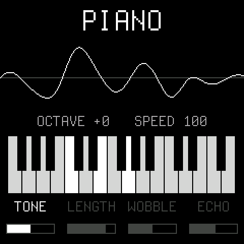
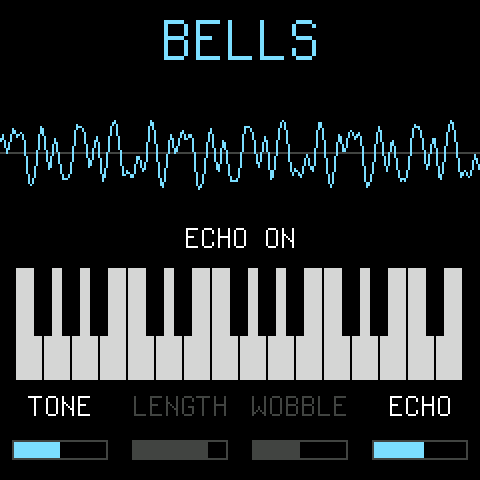
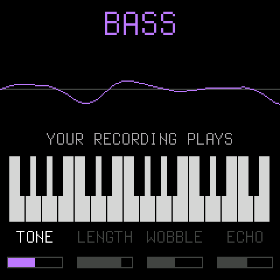
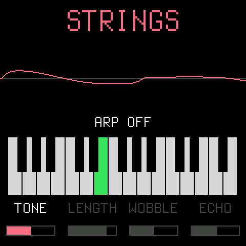

# Wren

**A first real instrument for a child of five to seven, on the M-VAVE FM-1.**

Wren replaces the FM-1's firmware with a small keyboard instrument that follows three rules:

1. **Nothing plays unless she plays it.** No demo songs and no backing band. The only things that repeat are what
   she recorded herself and a plain drum beat she switches on.
2. **Real instruments with their real names.** Piano, organ, bells, guitar, bass, strings, brass, flute. No cartoon
   characters and no funny noises.
3. **Every button does what is printed on it, always.** There are no pages, modes or menus, and HOME always goes
   home.

<p>




</p>

> **Status: 0.1, not yet run on a real FM-1.** Everything here was checked in the host simulator
> (`tests/run_host.sh`), which runs the same code and writes the screen and the sound to files. The device package
> is built by GitHub Actions. Install the first build with a computer nearby and read
> [If it goes wrong](docs/MANUAL.md#if-it-goes-wrong) first. Installing firmware is at your own risk.

## What every control does

| Control | What it does |
| --- | --- |
| Keys | Play. Ten notes at once. The key lights show what sounds. |
| **PRESETS** | The instrument: PIANO, ORGAN, BELLS, GUITAR, BASS, STRINGS, BRASS, FLUTE. |
| **OCT-**, **OCT+** | Lower, higher. |
| **KNOB 1** | TONE: dark to bright. |
| **KNOB 2**, **ENV** | LENGTH: how long notes ring. The knob sets how much, ENV switches it on and off. |
| **KNOB 3**, **LFO** | WOBBLE: vibrato. The knob sets how much, LFO switches it on and off. |
| **KNOB 4**, **FX** | ECHO. The knob sets how much, FX switches it on and off. |
| **ARP** | Held keys play one after the other. |
| **SEQ** | A drum beat to play along with. |
| **ALGORITHM** | SPEED of the beat, the arp and the recording (60 to 180). |
| **REC** | Record what you play. REC again and it goes round. REC while it plays adds a layer, with any instrument. |
| **PLAY** | The recording on and off. |
| **EDIT** | Tap: take the last layer away. Hold a second: erase the recording. |
| **SAVE** | Keep the recording for next time. |
| **SEL**, **SELECT** | Follow the lights: the next key of a tune is lit green and waits for her. SELECT picks the tune (nine traditional ones). She plays every note; nothing is played for her. |
| **GLO** | The two C keys glow, to find your way. |
| **HOME** | Back to the start: piano, everything off. The recording is kept. |
| **MASTER** | Volume. |
| **HOME held 3 s** | For grown-ups: QUIET, half the loudness, kept over power-off. |

The screen shows the instrument's name, the sound's wave, one line that says what is going on, the keyboard, and
the four knobs with their names.

More in the [manual](docs/MANUAL.md).

## Build it

Wren is built on [Dinghy](https://github.com/zvenson/dinghy), which carries
[Felucca](https://github.com/hugelton/Felucca)'s platform: the updater, the USB rescue, USB-MIDI, USB audio.

```sh
tests/run_host.sh tests/scripts/tour.txt    # no FM-1 needed: build/host/wren.wav and the screens as PNG
```

For the FM-1 itself you need Linux on x86-64, Python 3 with Pillow, JieLi's toolchain and its AC79 SDK:

```sh
pip3 install Pillow mido python-rtmidi
tools/get_toolchain.sh
git clone --depth 1 --branch AC79NN_SDK_V1.2.1_2023-12-13 \
    https://gitee.com/Jieli-Tech/fw-AC79_AIoT_SDK.git ~/fw-AC79_AIoT_SDK
./build.sh                                        # -> build/wren.fwsc
python3 tools/fm1_install.py build/wren.fwsc      # over USB; asks before it writes
```

Or let GitHub build it: every push to `main` runs `.github/workflows/release.yml` and keeps `wren.fwsc` as a build
artifact; a tag `v0.1` publishes a release.

The instrument is one file, [firmware/src/wren.c](firmware/src/wren.c). The platform's calls are in
[docs/API.md](docs/API.md), the chip's rules in [docs/RULES.md](docs/RULES.md).

## Licence

GPL-3.0-only, as Dinghy and Felucca. Credits and third-party parts: [LICENSING.md](LICENSING.md).

M-VAVE and FM-1 are trademarks of their owners. Wren is independent of M-VAVE, Hügelton Instruments and Dinghy.
