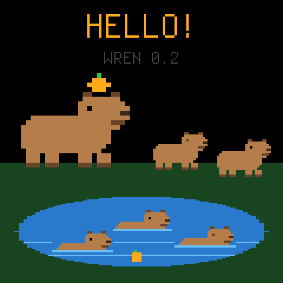
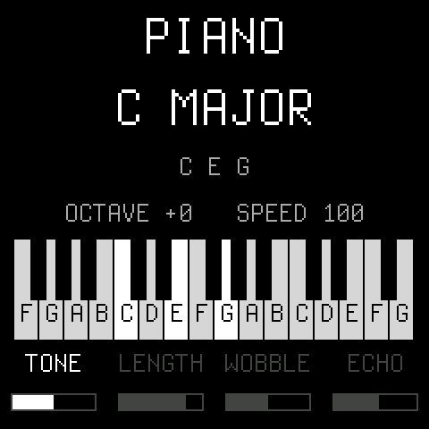
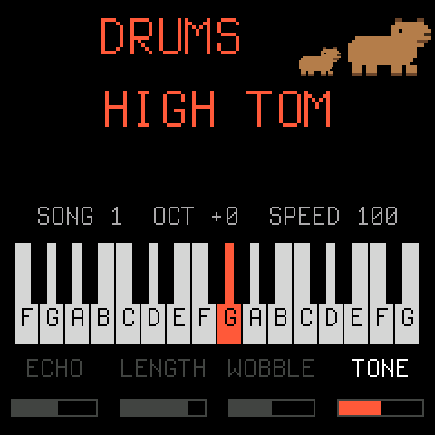
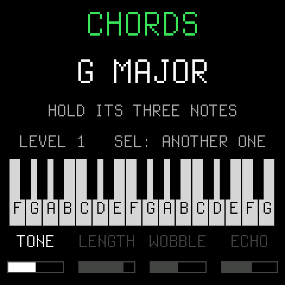
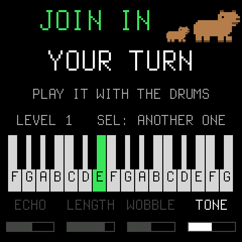
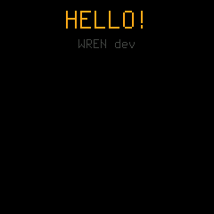

# Capy

**A first real instrument for a child of five to seven, on the M-VAVE FM-1.**

Capy replaces the FM-1's firmware with a small keyboard instrument made for a young child:

- **Nine instruments with their real names:** piano, organ, bells, guitar, bass, strings, brass, flute and a drum
  kit. The screen names every note and chord played, so what a child learns here is true at any piano.
- **A band the child leads.** It starts with its drums alone. One low key picks the chord, and the bass and the
  chords follow.
- **Seven games that don't run out.** They make their questions up, get a little harder after five right answers
  and remember their level. A wrong answer takes nothing away.
- **Four songs to record,** in layers, with any instrument.
- **A pond of capybaras** as the home screen.

<p>









</p>

A capybara and her baby sit beside the instrument's name. The capybara sings when notes sound, nods to the band,
blinks, and gets a yuzu on her head for a chord or a right answer. A right answer also makes the lights under the
keys glow once. HOME (and switching on) shows their pond, which stays until the child plays or picks something.
Little scenes play there one after the other (a baby jumps into the water, rides on her mother's back, a wren
lands and sings, the mother dozes off, yuzus drop in for a bath), and OCT- and OCT+ step through them. For every
three levels gained in the games, another baby moves into the pond, up to five.

## Install

Installing firmware is at your own risk. So far Capy has been installed on one FM-1, from Windows, over another
community firmware. Installing it over M-VAVE's own firmware has not been tried yet.

1. Download this repository as a [ZIP file](https://github.com/trapperl/capy-fm1/archive/refs/heads/main.zip) and
   unpack it. You get a folder `capy-fm1-main` with the firmware, `capy.fwsc`, and its installer inside.
2. Install [Python 3](https://www.python.org/downloads/). On Windows, tick "Add python.exe to PATH" in its
   installer.
3. Open a terminal in the `capy-fm1-main` folder. On Windows: open the folder in Explorer, type `cmd` in the
   address bar and press Enter.
4. Type this and press Enter. It installs the two Python packages the installer needs:

   ```
   pip install mido python-rtmidi
   ```

5. Connect the FM-1 to the computer with a USB **data** cable and switch it on.
6. Type this and press Enter:

   ```
   python tools/fm1_install.py capy.fwsc
   ```

   It shows which FM-1 it found and asks "Install?". Type `y` and press Enter. Don't unplug the FM-1 while it
   writes. After a minute or two the FM-1 restarts and shows Capy's pond.

If it says "FM-1 not found", check that the cable carries data and that no other program is using the FM-1. The
[manual](docs/MANUAL.md) covers what else can [go wrong](docs/MANUAL.md#if-it-goes-wrong), how to go back to
M-VAVE's firmware, and what to set before handing the FM-1 to a child.

## Playing

| Control | What it does |
| --- | --- |
| Keys | Play notes, up to twelve at once. The screen names what is held: a note's letter, several letters, or the chord ("C MAJOR", "A MINOR", "G7"). |
| **PRESETS** | Picks the instrument: PIANO, ORGAN, BELLS, GUITAR, BASS, STRINGS, BRASS, FLUTE or DRUMS. DRUMS puts a drum kit on the keys (C kick, D snare, E clap, F and G toms, A hat, B cymbal, the black keys sticks), and the screen names each drum as it is hit. |
| **OCT-**, **OCT+** | An octave lower or higher. |
| **KNOB 1**, **FX** | ECHO. The knob sets how much; FX switches it on and off. |
| **KNOB 2**, **ENV** | LENGTH: how long notes ring. The knob sets how much; ENV switches it on and off. |
| **KNOB 3**, **LFO** | WOBBLE: vibrato. The knob sets how much; LFO switches it on and off. |
| **KNOB 4** | TONE: dark to bright. |
| **GLO** | Switches between the note letters (on the screen's keyboard, and for the keys held) and a picture of the sound's wave. |
| **ARP** | Plays the held keys one after the other, in time. |
| **SEQ** | Each press moves on: CLICK (a metronome), then four bands (POP, BLUES, WALTZ, LULLABY), then off. A band starts with its drums alone. One of the seven lowest white keys (marked orange on the screen) picks a chord, and the bass and the chords play it until another is picked. The screen names the chord, and the keys that fit it glow. |
| **ALGORITHM** | The speed of the click, the band, the arp and the recording (60 to 180 beats a minute). |
| **SELECT** | Picks one of four songs, SONG 1 to SONG 4. REC, PLAY, SAVE and EDIT work on the one that shows. A song that changed is saved when you turn away from it. |
| **REC** | Records what is played. Press it again and the recording loops. REC while it plays adds a layer, with any instrument. |
| **PLAY** | Starts and stops the recording. |
| **EDIT** | Tap: remove the last layer. Hold for a second: erase the recording. |
| **SAVE** | Keeps the song that shows, so it is still there after switching off. |
| **SEL** | Opens the games. |
| **HOME** | Back to the start: piano, everything switched off, and the pond. The recording is kept. |
| **MASTER** | Volume. |
| **HOME held 3 s** | For grown-ups: QUIET halves the loudness, and stays on after switching off. |

## The games

**SEL** opens the games, **SELECT** picks one, **SEL** again asks for another question, **SEQ** switches a
metronome click on and off, and **HOME** leaves. The instruments, the knobs and the keys work as always.

| Game | How it is played | How it grows |
| --- | --- | --- |
| **TUNES** | The next key of a tune lights green and waits, and the screen says its letter. With each right note a band plays along, at the child's own pace. | Nine traditional tunes, one after the other. |
| **FIND IT** | The screen shows a letter; the child finds that key. A wrong key is named ("THAT WAS C"), and after two tries the right keys light up. | C D E, then up to G, then all white keys, then the black keys. |
| **COPY ME** | It plays a few notes, to be played back. Each time that goes right, it adds a note. | From 2 notes up to 12, on more keys. |
| **HIGH LOW** | It plays two notes: was the second higher or lower? The answer is OCT+ or OCT-. | From an octave apart down to neighbouring keys. |
| **CHORDS** | The screen names a chord; the child holds its three notes. After a while without them, the keys light up. | C, F and G, then the minor chords, then any key. |
| **JOIN IN** | Drums play. For one bar it plays a short tune over them while the keys light; the next bar is the child's turn, with each key lit as its turn comes. If the tune isn't finished by the end of the bar, it comes round again. | From three notes on the beats to seven on any eighth note. |
| **TAP IT** | A drum plays a rhythm, shown as boxes on the screen, to be tapped back on any key. | From three slow hits to six quick ones. |

## Changing Capy

Capy is open source. The whole instrument is one C file, [firmware/src/capy.c](firmware/src/capy.c), built on
[Dinghy](https://github.com/zvenson/dinghy) and [Felucca](https://github.com/hugelton/Felucca). How to build the
firmware yourself is in [docs/DEVELOPING.md](docs/DEVELOPING.md).

## Licence

GPL-3.0-only, as Dinghy and Felucca. Credits and third-party parts: [LICENSING.md](LICENSING.md).

M-VAVE and FM-1 are trademarks of their owners. Capy is independent of M-VAVE, Hügelton Instruments and Dinghy.
